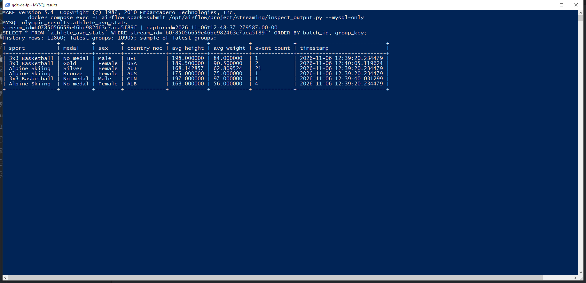
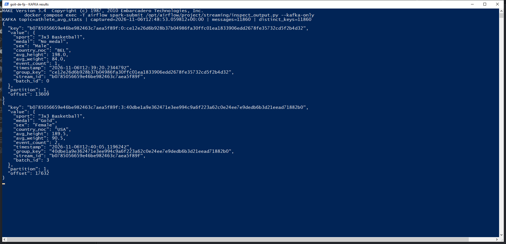

# goit-de-fp — фінальний проєкт Data Engineering

Проєкт складається з двох частин: Spark Structured Streaming (MySQL → Kafka → агрегати → Kafka та MySQL) і Batch Data Lake (CSV → bronze → silver → gold із запуском через Airflow).

Підготовлено локальне середовище та реалізовано Streaming Pipeline. Файли в `batch/` і `dags/project_solution.py` містять заготовки для другої частини. Попередній DAG `olympic_medals` збережено.

Звіт про виконання проєкту ведеться українською мовою безпосередньо в цьому README. Результати наступних етапів і знімки екрана слід додавати до відповідних розділів нижче.

## Звіт: підготовка середовища

Дата виконання: 6 листопада 2026 року. За вибором користувача використано локальну MySQL та оригінальні CSV із завдання.

| Компонент | Результат |
| --- | --- |
| Compose | Окремий проєкт `goit-de-fp`: MySQL, Kafka та Airflow зі Spark |
| Spark | 4.1.1, Scala 2.13, Java 17, Python 3.12, master `local[2]` |
| Вхідна схема | `olympic_dataset` |
| `athlete_bio` | Імпортовано 155 861 рядок; значення `athlete_id` унікальні |
| `athlete_event_results` | Імпортовано 316 834 рядки |
| Вихідна схема | `olympic_results`; локальному користувачу надано права запису |
| Kafka | Створено топіки `athlete_event_results`, `athlete_avg_stats`, `environment_check` |
| Сховище | Спільні каталоги landing/bronze/silver/gold і checkpoints на хості |
| Облікові дані | Випадкові локальні паролі збережено в `.env`, який виключено з Git |

Образ успішно зібрано. Перевірка залежностей `python -m pip check` повернула `No broken requirements found`. Команда `make check` завершилася з кодом 0:

```text
PASS Spark 4.1.1: JVM and Python workers
PASS JDBC athlete_bio: 155861 rows
PASS JDBC athlete_event_results: 316834 rows
PASS output MySQL: write/read/drop scratch table
PASS Kafka: message written and read back
PASS shared data/checkpoint paths and Airflow spark-default connection
```

Перевірено виконання Spark і Python workers, читання обох таблиць через JDBC, запис і читання вихідної MySQL-схеми, обмін повідомленням через Kafka, доступ до спільних каталогів і з'єднання Airflow `spark-default`.

Повний локальний журнал збережено в `artifacts/environment-check.log` і виключено з Git. Перевірочні повідомлення залишаються в окремому топіку `environment_check`; тимчасову перевірочну таблицю MySQL видалено після успішної перевірки.

## Звіт: частина 1 — Streaming Pipeline

Виконано та перевірено 6 листопада 2026 року. `make stream`, `make results` і `make test` завершилися успішно.

| Показник | Результат потоку `b0785056659e46be982463c7aea5f89f` |
| --- | --- |
| Біографій до / після очищення | 155 861 / 104 153 |
| Повідомлень у вхідному Kafka-топіку | 316 834 — відповідає кількості вихідних виступів MySQL |
| Виступів після об'єднання з очищеними біографіями | 226 887 |
| Актуальних груп | 10 905 |
| Груп без медалі | 6 525 |
| Оброблених мікробатчів | 4 |
| Оновлень у MySQL / Kafka | 11 860 / 11 860 |
| Незалежна перевірка | Усі ключі, кількості та середні збігаються; вміст обох приймачів і час до мікросекунд збігаються |
| Повторний запуск із тим самим checkpoint | 0 повторно прочитаних повідомлень; ідентифікатор потоку збережено |

Фактичні MySQL-агрегати поточного потоку:



Фактичні JSON-повідомлення вихідного Kafka-топіка:



Знімки зроблено з реальних вікон PowerShell під час виконання `make results` в окремих режимах перегляду MySQL і Kafka. Локальний скрипт `artifacts/capture_screenshots.py`, допоміжні скрипти та журнали виключені з Git; готові PNG збережено в `img/streaming/`.

Потік даних: `olympic_dataset.athlete_event_results` → Kafka `athlete_event_results` → Spark Structured Streaming + `olympic_dataset.athlete_bio` → Kafka `athlete_avg_stats` і MySQL `olympic_results.athlete_avg_stats`.

| Вимога | Реалізація |
| --- | --- |
| Прочитати фізичні показники з MySQL | Spark JDBC у `streaming/streaming_pipeline.py` |
| Відфільтрувати некоректні зріст і вагу | `clean_bio()` у `streaming/transforms.py`: прибирання крайових Unicode-пробілів, безпечне перетворення на DOUBLE, відкидання NULL, NaN і нескінченностей |
| Передати результати змагань через Kafka | `streaming/mysql_to_kafka.py` читає MySQL та публікує всі поля як JSON; потік читає Kafka через `readStream`, а `parse_events()` розгортає явну схему |
| Об'єднати за `athlete_id` | `enrich_events()` виконує stream-static inner join; дублікати ключів очищеної біографії спричиняють помилку |
| Розрахувати середні та час | `aggregate_events()` групує за `sport`, `medal`, `sex`, `country_noc`; callback додає UTC-мітку `timestamp` |
| Записати у два приймачі через `foreachBatch` | `make_sink()` записує той самий набір у MySQL через JDBC та у вихідний Kafka-топік |

`country_noc` береться з біографії атлета. Відсутня або порожня медаль утворює категорію `No medal`. Повторні виступи одного атлета враховуються як окремі записи. Пошкоджені JSON-повідомлення, записи без `athlete_id` або виду спорту відкидаються; виступи без відповідної очищеної біографії не проходять inner join.

Агрегати накопичуються за всіма обробленими виступами. Режим `update` передає змінені групи в `foreachBatch`; середні не обмежуються поточним мікробатчем. `event_count` показує кількість виступів у групі. `timestamp` однаковий для обох приймачів і зберігається при повторі запису того самого мікробатча.

MySQL зберігає історію оновлень із первинним ключем `(stream_id, batch_id, group_key)`. Актуальний стан — рядок із найбільшим `batch_id` для кожного `group_key` у межах одного `stream_id`. Новий checkpoint створює окремий потік; історія попередніх потоків зберігається. Kafka key має формат `stream_id:batch_id:group_key`.

Спочатку callback записує DataFrame через JDBC у staging-таблицю, потім виконує транзакційний upsert в історію MySQL і надсилає ті самі агрегати в Kafka. Staging успадковує схему вихідної таблиці, зокрема `DATETIME(6)` для збереження мікросекунд. Помилки передаються Spark. Повтор мікробатча не створює дублікатів у MySQL; Kafka має гарантію at-least-once і може містити повтори з тим самим ключем та вмістом. Спільної атомарної транзакції між MySQL і Kafka немає. Кешування DataFrame дозволяє повторно використати один розрахунок для двох записів. [Семантика foreachBatch у Spark](https://spark.apache.org/docs/4.1.1/streaming/apis-on-dataframes-and-datasets.html#using-foreach-and-foreachbatch).

Запуск після підготовки середовища:

```powershell
make stream
make results
make test
```

`make stream` публікує знімок вихідних результатів один раз, а потім запускає справжній Kafka stream із `trigger(availableNow=True)`: усі доступні події обробляються мікробатчами до 100 000 повідомлень, після чого job завершується. Скрипт також підтримує роботу без `--available-now` з інтервалом 10 секунд.

Повторний `make stream` використовує маркер продюсера та той самий checkpoint, тому не публікує знімок заново й продовжує з підтверджених offsets. Не видаляйте checkpoint для звичайного перезапуску. Біографії в цьому навчальному потоці вважаються незмінним довідником. При зміні схеми або логіки stateful-обробки потрібен новий checkpoint. Блокування файла не дозволяє одночасно запускати дві копії з одним checkpoint.

Продюсер захищає від випадкового повторного завантаження маркером у `checkpoints/`. Прапорець `--force` свідомо повторює публікацію та збільшує кількість вхідних подій. Якщо публікацію перервано до створення маркера, можливий частково записаний топік: його стан потрібно перевірити перед повторним завантаженням.

`make results` виводить фактичні дані MySQL і Kafka та перевіряє всі групи незалежним розрахунком на Python із прямим читанням MySQL. Порівнюються ключі, кількість виступів, середні, відповідність усієї історії Kafka/MySQL та часові мітки. Вхідний Kafka-топік додатково перевіряється на повноту відносно джерела.

Для окремого перегляду без повторної повної перевірки можна передати аргументи через змінну середовища; `-e` підтримує її перевизначення у GNU Make та Embarcadero Make:

```powershell
$env:RESULTS_ARGS = "--mysql-only"
make -e results
$env:RESULTS_ARGS = "--kafka-only"
make -e results
Remove-Item Env:RESULTS_ARGS
```

`make test` перевіряє порожні й нечислові значення, NaN, нескінченності, нерозривні пробіли, пошкоджений JSON, відсутні ключі, невідповідні біографії, походження країни, відсутність медалі, середні та порожній мікробатч. Окремо моделюється збій перед Kafka після успішного запису MySQL; повтор перевіряється на відсутність дублікатів, збереження часової мітки та точності до мікросекунд. Використовуються окрема тимчасова таблиця та топік `environment_check`.

## Звіт: частина 2 — Batch Data Lake

Реалізацію ще не виконано. Після завершення потрібно описати три Spark jobs, виконання DAG і додати знімки екрана:

- `img/batch/bronze_show.png` — результат першої job у журналах Airflow.
- `img/batch/silver_show.png` — результат другої job у журналах Airflow.
- `img/batch/gold_show.png` — результат третьої job у журналах Airflow.
- `img/batch/dag_success.png` — граф успішно виконаного DAG.

Для знімків із журналів мають бути видимі виведення `df.show()` і часові мітки. Знімки слід додавати після фактичного виконання відповідних етапів.

## Локальне середовище

Потрібні Docker Desktop із Linux containers, Docker Compose, Make та Python 3 на хості. Для керування Docker-середовищем використовувати команди `make` з кореня проєкту. Якщо потрібної команди немає, додати ціль у Makefile та опис у `make help`.

Для розробки орієнтовно потрібно виділити Docker 4 CPU та 8 ГБ RAM для Airflow, JVM Spark, MySQL і Kafka.

| Компонент | Версія / режим |
| --- | --- |
| Airflow | 2.11.2, Python 3.12, standalone / SequentialExecutor |
| Java | OpenJDK 17 |
| Spark / PySpark | 4.1.1, `local[2]` у контейнері Airflow |
| Airflow Spark provider | 5.5.1 |
| Spark Kafka connector | `spark-sql-kafka-0-10_2.13:4.1.1` |
| MySQL JDBC | `mysql-connector-j:8.0.33` |
| Kafka | 3.9.1, один вузол KRaft |
| MySQL | 8.4.8 |

Python хоста використовується для налаштування та завантаження CSV. Spark виконується з Python 3.12 усередині контейнера. Версії Python-залежностей узгоджено з [constraints Airflow 2.11.2](https://raw.githubusercontent.com/apache/airflow/constraints-2.11.2/constraints-3.12.txt). Java, Python і Scala вибрано за [вимогами Spark 4.1.1](https://spark.apache.org/docs/4.1.1/). Maven-пакети завантажуються під час першого запуску Spark і зберігаються в Docker volume `spark_ivy`; для першої збірки та перевірки потрібен інтернет.

Обидві частини виконуються локально. Вхідні таблиці розташовані в `olympic_dataset`, результати записуватимуться в окрему схему `olympic_results`. Доступ до навчальної БД для вибраного варіанта не потрібен.

## Перший запуск

Виконати з кореня проєкту:

```powershell
make init
make download
make run
make seed
make topics
make check
```

`make init` створює каталоги та `.env` із випадковими локальними паролями, зберігаючи наявний `.env`. Після зміни прикладу вручну додайте нові ключі до свого `.env`. Значення `.env` не публікуються. Зміна файла не змінює пароль уже створеного користувача MySQL.

`make download` завантажує CSV з адрес, наведених у завданні, до `data/landing/` без зміни вмісту. `make seed` створює та заповнює локальні таблиці MySQL; наявні непорожні таблиці зберігаються. Щоб зберегти початкові некоректні значення для подальшого очищення, поля мають тип TEXT, крім числового `athlete_id`. Імпорт фіксується однією транзакцією для кожної таблиці.

`make topics` створює три стандартні локальні топіки з прикладу. `make check` запускає перевірку середовища, результати якої наведено у звіті вище.

## Налаштування та доступ

Спільні налаштування наведено в `.env.example`; модуль `project_config.py` читає їх зі змінних середовища. Адреси `mysql:3306` і `kafka:9092` доступні всередині Compose. Порти Kafka та MySQL на хост не опубліковано. Для перевірки даних використовуйте `make check`, для перегляду журналів — `make logs`.

Airflow доступний за адресою <http://localhost:8080>, користувач `admin`. Отримати пароль адміністратора:

```powershell
make password
```

Для використання навчальної БД змініть `SOURCE_MYSQL_*` у `.env` і застосуйте налаштування через `make run`. Вихідну локальну БД можна залишити без змін. Для зовнішньої Kafka задайте bootstrap servers і параметри `KAFKA_SECURITY_PROTOCOL`, `KAFKA_SASL_MECHANISM`, `KAFKA_SASL_JAAS_CONFIG`; використовуйте дозволені на навчальному стенді назви топіків. Зміна джерел або приймачів потребує окремого checkpoint; скрипт перевіряє відповідність конфігурації.

З'єднання Airflow `spark-default` задано через змінні середовища: master `local[2]`, deploy mode `client`. Для jobs використовуйте абсолютні шляхи `/opt/airflow/project/batch/...`. Проєкт змонтовано в `/opt/airflow/project`; Data Lake і checkpoints доступні всім локальним jobs.

Для навчального кластера потрібно окремо налаштувати адресу Spark, доступне кластеру сховище, шляхи скриптів і з'єднання Airflow. Локальні шляхи потрібно адаптувати до кластера.

## Структура проєкту

- `streaming/` — виробник подій, потокова обробка, спільні перетворення та перевірка результатів.
- `batch/` — заготовки трьох Spark jobs.
- `dags/project_solution.py` — заготовка DAG фінального проєкту.
- `scripts/` — підготовка, завантаження CSV, імпорт локальної БД і перевірка середовища.
- `scripts/check_streaming.py` — перевірка перетворень і повторної обробки після збою.
- `project_config.py`, `spark-defaults.conf` — спільні налаштування та Spark-конектори.
- `data/landing`, `data/bronze`, `data/silver`, `data/gold` — локальні дані, виключені з Git.
- `checkpoints/` — стан потокової обробки, виключений із Git.
- `img/streaming/`, `img/batch/` — знімки екрана відповідно до позначок у плані.
- `docs/` — локальні матеріали завдання та чек-лист, виключені з Git; звіт ведеться в `README.md`.
- `artifacts/` — тимчасові журнали, результати перевірок, HTML для знімків та локальний скрипт їх створення; виключені з Git.
- `mysql/bootstrap/` — створення вихідної схеми під час першого запуску нового MySQL volume.
- `mysql/init/` — збережені скрипти попередньої роботи; новий Compose їх не запускає.

Заготовки batch jobs під час прямого запуску повідомляють, що реалізація ще відсутня. DAG фінального проєкту буде додано під час виконання другої частини.

## Повторний запуск і зупинка

Перелік доступних команд — `make help`.

| Команда | Дія |
| --- | --- |
| `make run` | Зібрати й запустити середовище та дочекатися готовності |
| `make status` | Показати стан контейнерів |
| `make logs` | Переглядати журнали; вихід через Ctrl+C |
| `make password` | Показати пароль адміністратора Airflow |
| `make check` | Перевірити Spark, MySQL, Kafka та спільні каталоги |
| `make stream` | Опублікувати джерело один раз і обробити доступні події |
| `make results` | Вивести й перевірити результати обох приймачів |
| `make test` | Перевірити перетворення та повтор запису після збою |
| `make stop` | Зупинити контейнери зі збереженням даних |

```powershell
make run
make status
make check
make stop
```

`make stop` зберігає контейнери, volumes, локальні дані та checkpoints для наступного запуску. Попередні volumes проєкту `goit-de-hw-07` новим проєктом не використовуються.
