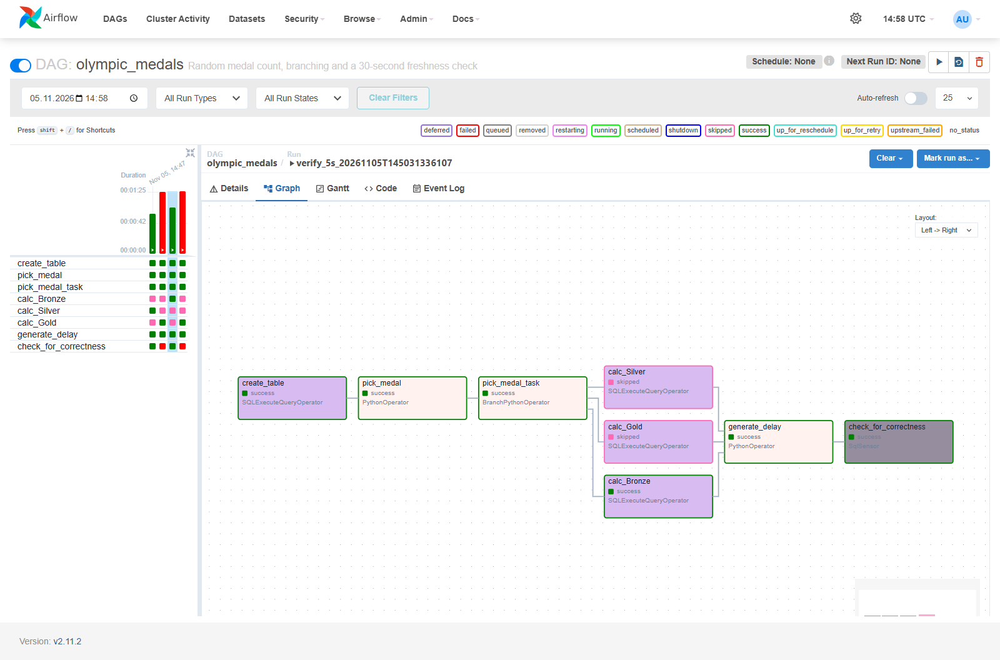
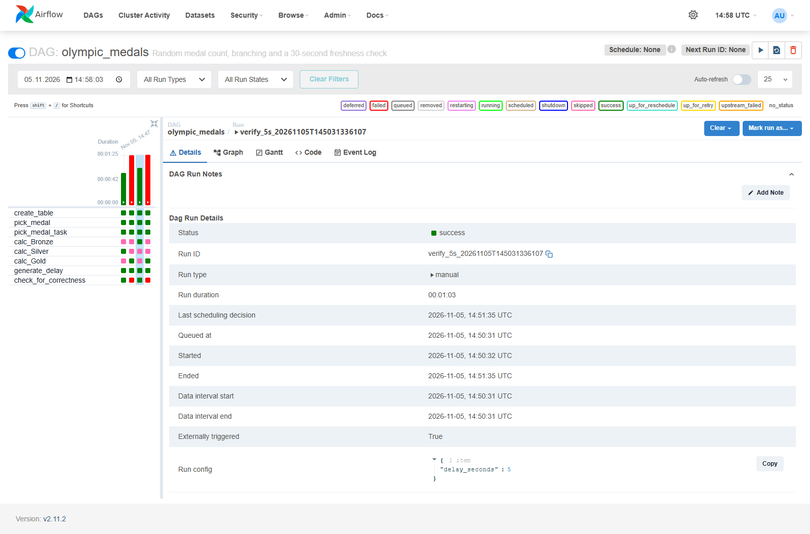
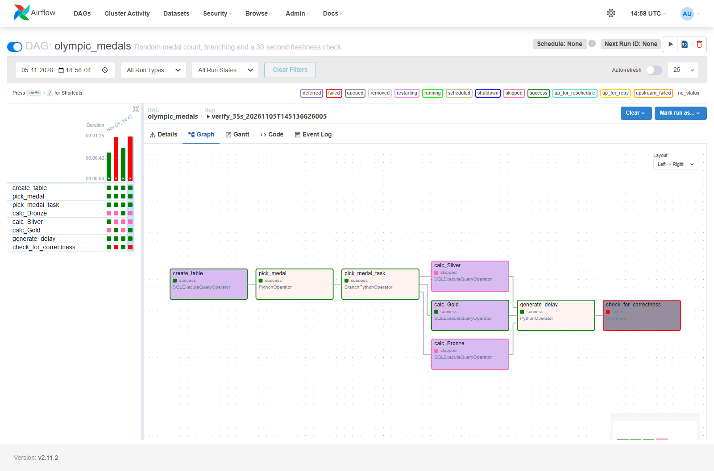
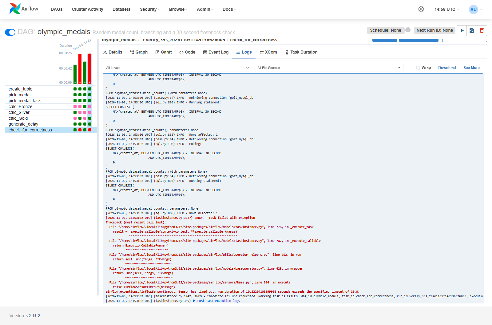
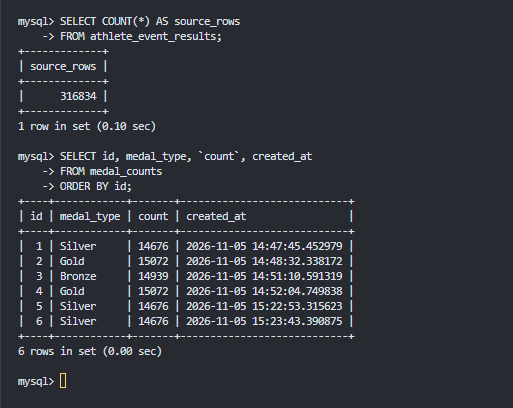

# goit-de-hw-07 — Apache Airflow + MySQL

Домашнє завдання до теми «Apache Airflow».

DAG `olympic_medals` випадково обирає Bronze, Silver або Gold, запускає відповідну
гілку підрахунку рядків у `olympic_dataset.athlete_event_results` і записує
результат у `medal_counts`. Після заданої затримки `SqlSensor` перевіряє,
що останній запис не старший за 30 секунд. Усе працює локально у двох
контейнерах: MySQL 8.4.8 та Airflow 2.11.2 у режимі `standalone`.

## Структура проєкту

- `dags/olympic_medals_dag.py` — DAG із восьми завдань: створення таблиці →
  випадковий вибір медалі → розгалуження → одна з трьох SQL-задач підрахунку →
  затримка → перевірка свіжості запису.
- `mysql/init/00_copy_dataset.sh`, `mysql/init/01_dataset.sql` — підготовка
  CSV та завантаження даних у MySQL через `LOAD DATA INFILE` під час першого запуску.
- `data/athlete_event_results.csv` — локальні вихідні
  результати олімпійських змагань: 316 834 рядки.
  `athlete_bio.csv` у цьому завданні не використовується.
- `Dockerfile`, `compose.yaml`, `requirements.txt`, `Makefile` — збирання,
  запуск і перевірка локального середовища.
- `.env.example` — приклад налаштувань MySQL; локальні паролі зберігаються в `.env`.
- `img/` — скриншоти виконання; результати перевірки наведено нижче в таблиці.

## Запуск

Потрібні Docker Desktop із контейнерами Linux, Docker Compose, Make та Python 3
на хості. Makefile сумісний із GNU Make та Embarcadero Make.
Команди виконувати з кореня проєкту.

Каталог `data/` виключено з Git. Перед першим запуском завантажити
[athlete_event_results.csv](https://ftp.goit.study/neoversity/athlete_event_results.csv)
і зберегти його в `data/athlete_event_results.csv`.

1. Створити `.env` із прикладу та за потреби змінити локальні паролі:

   ```powershell
   make init
   ```

   Наявний `.env` зберігається. Для пароля MySQL використовуйте символи,
   безпечні для URL, наприклад літери й цифри. Зміна `.env` сама по собі
   не змінює пароль користувача вже створеної бази.

2. Зібрати образ Airflow та запустити обидва контейнери:

   ```powershell
   make run
   ```

   Команда чекає на готовність сервісів. Під час першого запуску MySQL
   імпортує CSV; повторні запуски зберігають дані та не повторюють імпорт.

3. Перевірити стан контейнерів та отримати пароль адміністратора:

   ```powershell
   make status
   make password
   ```

   Відкрити <http://localhost:8080>, увійти як `admin`.
   Для перегляду логів використати `make logs` (вихід через Ctrl+C).

4. Запустити DAG вручну та переглянути результати:

   Увімкнути DAG `olympic_medals` в UI, натиснути Trigger DAG і задати
   `delay_seconds=5`. Дочекатися завершення: обрана гілка, затримка та сенсор
   мають отримати `success`, дві необрані гілки — `skipped`.
   Потім запустити DAG із `delay_seconds=35`: сенсор має завершитися
   з помилкою `AirflowSensorTimeout`, а DAG — зі статусом `failed`.
   Фактичний вік запису враховує також час планування між завданнями.

   Переглянути рядки, створені DAG:

   ```powershell
   make results
   ```

   Для табличного виводу підключитися до MySQL (ввести `MYSQL_PASSWORD` із `.env`):

   ```powershell
   docker compose exec mysql mysql -u airflow -p olympic_dataset
   ```

   Якщо змінено `MYSQL_USER`, використати своє ім'я замість `airflow`.
   У консолі `mysql>` виконати:

   ```sql
   SELECT id, medal_type, `count`, created_at
   FROM medal_counts
   ORDER BY id;
   ```

   Скриншоти Graph, Grid, лога сенсора та результатів SELECT зберегти в `img/`.

5. Зупинити середовище зі збереженням даних:

   ```powershell
   make stop
   ```

   `make up` — повторний запуск без збирання образу, `make down` — видалення
   контейнерів зі збереженням томів, `make help` — список усіх команд.
   **`make clean` видаляє всі томи проєкту з даними MySQL, історією Airflow
   та логами, а також локальний образ Airflow.**

## Скриншоти виконання

**1. Успішний запуск DAG із затримкою 5 секунд — Graph**

Виконано гілку `calc_Bronze`, інші дві пропущено; сенсор завершився успішно.



**2. Успішний запуск — Grid і параметри запуску**



**3. Запуск із затримкою 35 секунд — Graph**

Підрахунок і затримка успішні, але запис застарів, тому сенсор отримав `failed`.



**4. Неуспішний запуск — Grid і параметри запуску**


**5. Лог сенсора з помилкою `AirflowSensorTimeout`**



**6. Таблиця результатів `olympic_dataset.medal_counts`**

Скриншот виконання запиту `SELECT` до таблиці `medal_counts`: ідентифікатор
запису, тип медалі, кількість рядків із цією медаллю та час створення запису в UTC.



Результати двох запусків DAG від 5 листопада 2026 року, показаних на скриншотах:

| Показник | Успішний сценарій | Сценарій із застарілим записом |
| --- | --- | --- |
| Run ID | `verify_5s_20261105T145031336107` | `verify_35s_20261105T145136626005` |
| Логічний час запуску, UTC | 14:50:31 | 14:51:36 |
| `delay_seconds` | 5 | 35 |
| Обрана медаль | Bronze | Gold |
| Кількість рядків із медаллю | 14939 | 15072 |
| ID запису в `medal_counts` | 3 | 4 |
| `created_at`, UTC | 14:51:10.591319 | 14:52:04.749838 |
| Started сенсора, UTC | 14:51:34.301880 | 14:52:51.282911 |
| Вік запису на старті сенсора, с | 23,710561 | 46,533073 |
| Статус сенсора | `success` | `failed` |
| Статус DAG | `success` | `failed` |
| Помилка сенсора | — | `AirflowSensorTimeout` |

Параметри й статуси отримано зі сторінок Details, Graph і Logs відповідних
запусків в Airflow, а записи та кількості — SQL-запитами до MySQL.
В успішному запуску виконано гілку `calc_Bronze`, у неуспішному — `calc_Gold`;
решта гілок отримали статус `skipped`.
На скриншоті MySQL цим запускам відповідають записи ID 3 та 4;
інші рядки належать до окремих запусків. Незалежний підрахунок у вихідній таблиці підтвердив:
Bronze — 14939, Silver — 14676, Gold — 15072.

Вік запису обчислено SQL-запитом як різницю між Started сенсора та `created_at`
відповідного запису. Час у таблиці наведено в UTC з мікросекундами.
Запис віком близько 23,71 секунди пройшов перевірку,
а запис віком близько 46,53 секунди перевищив поріг 30 секунд і спричинив
очікувану помилку сенсора після тайм-ауту.
